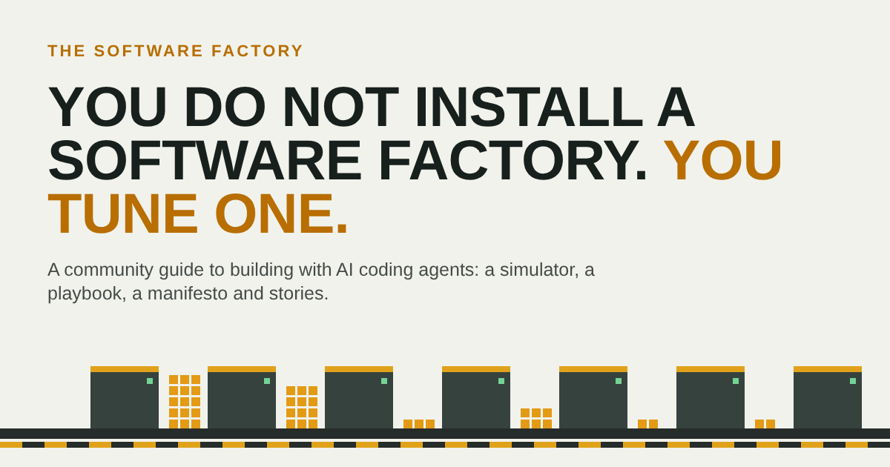

# The Software Factory

**You do not install a software factory. You tune one.**

A community guide to building a software factory with AI coding agents, live at **[thesoftwarefactory.site](https://thesoftwarefactory.site)**.

[](https://thesoftwarefactory.site)

Agents made writing code cheap. The rest of the delivery line was built for people who type, so it becomes the bottleneck: first CI and shared test environments, then one person's attention, then trust. Every fix moves the constraint somewhere else. This site is about doing that on purpose.

## What is here

| | | In this repo |
|---|---|---|
| **[Lights Out](https://thesoftwarefactory.site/lights-out/)** | A simulator of a delivery line. Find the constraint, automate it, and send every human home. You can load your own team's numbers. | `public/lights-out/` |
| **[The Playbook](https://thesoftwarefactory.site/playbook/)** | Plays that hold up in practice. Each opens with a scene and ends with a move for Monday. | `src/pages/playbook/` |
| **[Manifesto](https://thesoftwarefactory.site/manifesto/)** | What we believe about shipping software with agents, and what we refuse. | `src/pages/manifesto.md` |
| **[Journey](https://thesoftwarefactory.site/journey/)** | Six stages from autocomplete to lights out, and the constraint that shows up at each. | `src/pages/journey.astro` |
| **[Stories](https://thesoftwarefactory.site/stories/)** | Accounts from teams: where work piled up, what they changed, what broke next. | `src/pages/stories/` |

New to the idea? Start with [What is a software factory?](https://thesoftwarefactory.site/what-is-a-software-factory/)

## Open for argument

Every page is a file in this repository, and a pull request is the way to disagree.

- **A number in the simulator looks wrong.** All of them live in [`public/lights-out/model.js`](public/lights-out/model.js): station capacities, what each optimization multiplies, incident probabilities. They are estimates. Change one and say what you saw in a real team.
- **A play is missing, or does not hold its weight.** Each play is one Markdown file in [`src/pages/playbook/`](src/pages/playbook/).
- **You have a story.** One Markdown file in [`src/pages/stories/`](src/pages/stories/). Company names are optional.

See [`CONTRIBUTING.md`](CONTRIBUTING.md) for the details. Issues are welcome too, especially ones that start with "at my place it went differently".

## Run it locally

```
npm install
npm run dev
```

Requires Node 22 or newer. The site is built with [Astro](https://astro.build) and deployed to GitHub Pages by [`.github/workflows/deploy.yml`](.github/workflows/deploy.yml) on every push to `main`. Lights Out is plain HTML and JavaScript with no build step.

## Privacy

The site counts page views and a few game events with one small first-party script, [`public/analytics.js`](public/analytics.js), which sets no cookies. Google Analytics is loaded by [`public/consent.js`](public/consent.js) only for visitors who accept it, and they are asked once. The numbers typed into "My factory" never leave the browser. Details on the [privacy page](https://thesoftwarefactory.site/privacy/).

## Who is behind it

Started by [Ofir Makmal](https://il.linkedin.com/in/ofirmakmal), founder of [Marshal](https://marshal.codes) and [Runlease](https://runlease.online). He has led engineering at several startups as VP Engineering and CTO, and spent years as a consultant helping dozens of engineering teams tune both their software and the way they deliver it.

It is a community project: the point is for other people's experience to end up in here.

## License and credits

Code is MIT (see [`LICENSE`](LICENSE)). Written content is CC BY 4.0.

The GitHub mark in the navigation is GitHub's own icon from [Octicons](https://github.com/primer/octicons) (MIT).
